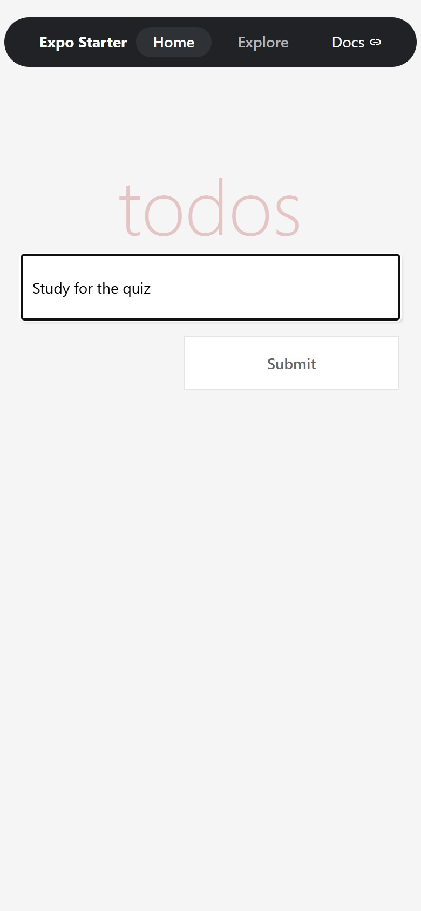
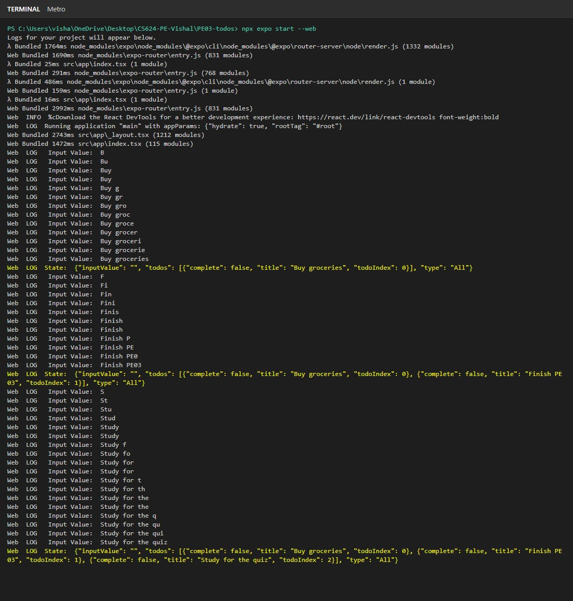
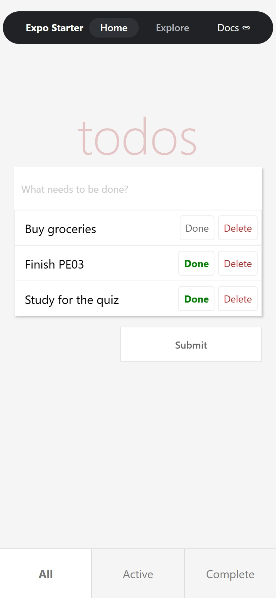
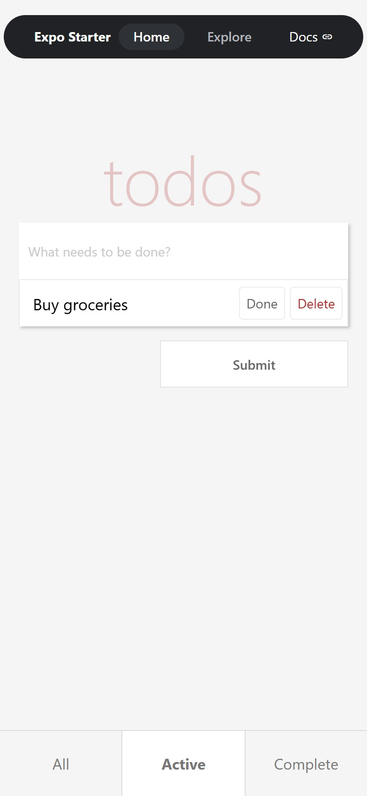
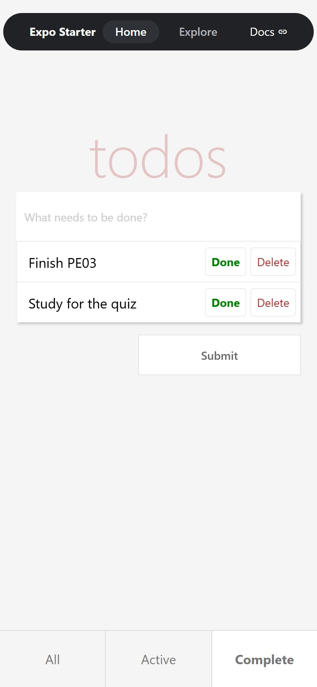
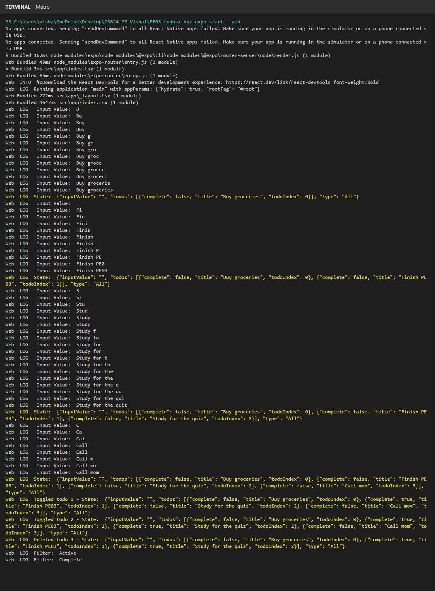

# Input

The user types a task into the "What needs to be done?" field and presses Submit to add it. Each task has a Done button and a Delete button, and the tab bar at the bottom lets the user pick All, Active, or Complete.

# Process

App.js is a class component that keeps the input text, the todos array, and the current filter in state. Typing calls inputChange, which updates inputValue. submitTodo skips empty input, creates a todo with a title, an index, and complete set to false, adds it to the array, clears the field, and logs the new state. toggleComplete flips a task's complete value, deleteTodo removes it, and setType changes the filter TodoList uses to choose which tasks to show.

# Output

The screen shows the heading, the input, the visible tasks, the Submit button, and the tab bar. Completed tasks show a bold green Done label, and the selected tab is highlighted. The terminal prints the state after every change.

## Screenshots

**Part 1: adding todos with the Submit button**

**Part 2: Done, Delete, and the tab bar filter**

| All | Active | Complete |
|---|---|---|
|  |  |  |

